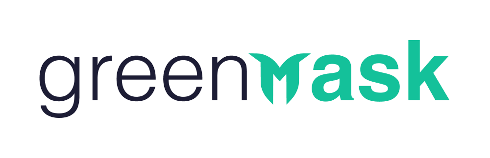
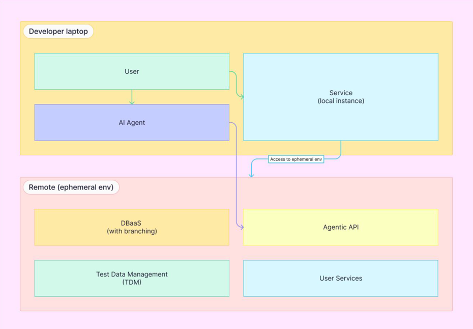

# Greenmask

Open-source Test Data Management (TDM) and data anonymization platform focused on secure production-like development
workflows.

Greenmask enables organizations to safely use realistic data in development, testing, staging, and AI-assisted
engineering environments without exposing sensitive information.

---

## Repositories

| Repository                                            | What it is                                                                                                                                                  |
|-------------------------------------------------------|-------------------------------------------------------------------------------------------------------------------------------------------------------------|
| [greenmask](https://github.com/GreenmaskIO/greenmask) | The Greenmask engine and CLI: dump, anonymize, subset, and restore databases. **Start here.**                                                               |
| [storages](https://github.com/GreenmaskIO/storages)   | Standalone Go library extracted from Greenmask: one interface for object storage with local filesystem, S3 (and compatibles), Azure Blob, SFTP, and in-memory backends. |
| [examples](https://github.com/GreenmaskIO/examples)   | Ready-to-run examples, integrations, and deployment scenarios for Greenmask.                                                                                |

---

## What Greenmask Provides

- **Data anonymization** — mask and transform sensitive data during logical dumps using configurable transformation
  pipelines.
- **Subsetting** — extract only the required portion of production data while preserving relational consistency.
- **Synthetic data generation** — generate realistic replacement values and datasets for non-production environments.
- **Test data management** — provision secure, production-like datasets for development, testing, staging, CI
  pipelines, and ephemeral environments, without keeping long-lived raw production copies around.

---

## How It Works

Greenmask is built around a stateless, stream-oriented architecture:

Database → Logical Dump Stream → Transformation Pipeline → Storage / Restore

- **In-flight anonymization** — transformations run directly within the dump stream.
- **No raw data at rest** — sensitive datasets never need to be persisted unmasked.
- **Stateless** — nothing to host or maintain between runs, which makes it easy to automate in CI and infrastructure
  pipelines.
- **Extensible** — built-in transformers can be complemented with your own.

This model is designed to support secure development and testing workflows in regulated and compliance-driven
environments.

---

## Supported Databases

| Database   | Status       |
|------------|--------------|
| PostgreSQL | Stable       |
| MySQL      | Experimental |

---

## Documentation & Community

- Website: https://www.greenmask.io
- Documentation: https://docs.greenmask.io
- Questions and ideas: [GitHub Discussions](https://github.com/GreenmaskIO/greenmask/discussions)
- Bug reports and feature requests: [GitHub Issues](https://github.com/GreenmaskIO/greenmask/issues)
- Chat: [Discord](https://discord.com/invite/rKBKvDECfd)
- Security: see the [Security Policy](https://github.com/GreenmaskIO/greenmask/blob/main/SECURITY.md) or write
  to [security@greenmask.io](mailto:security@greenmask.io)

For enterprise support and partnership inquiries, contact us through the website or
at [support@greenmask.io](mailto:support@greenmask.io).

---

## Future Platform Vision

Greenmask is evolving toward a platform designed for secure, production-like, ephemeral development environments.

Our long-term direction combines:

- Test Data Management (TDM)
- In-flight anonymization
- Ephemeral environments
- API-first infrastructure workflows
- AI-assisted development workflows
- DBaaS and infrastructure integrations

This architecture is intended to help developers and AI-assisted workflows rapidly provision isolated feature-specific
environments and safely iterate on realistic datasets.

Conceptual architecture:

This roadmap is being developed in collaboration with [Solanica](https://solanica.io/)
and [OpenEverest](https://openeverest.io/) as part of a broader effort to build open-source, enterprise-grade
infrastructure for modern software delivery workflows.

Read more in
the [announcement blog post](https://www.greenmask.io/blog/greenmask-openeverest-automating-safe-production-data).

---

## License

Greenmask is open-source software released under the Apache 2.0 License.
